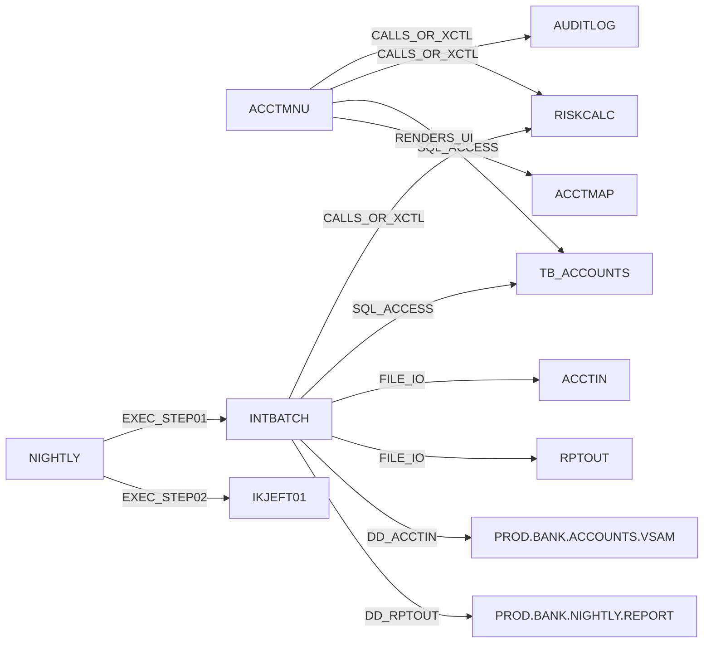
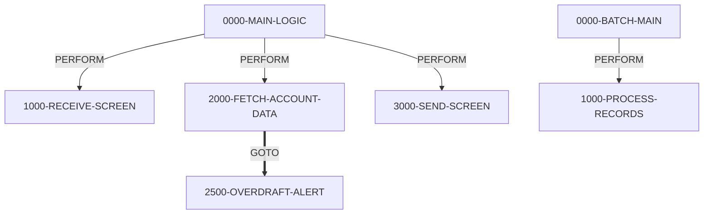
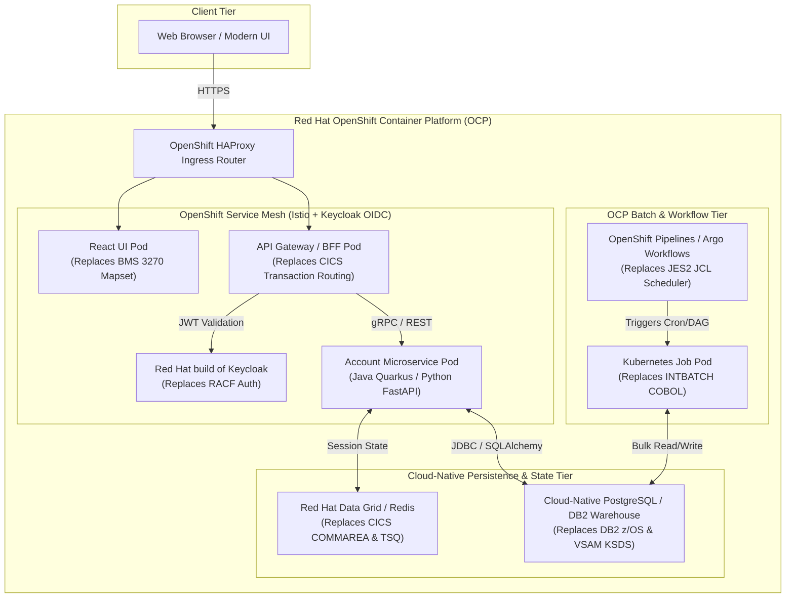
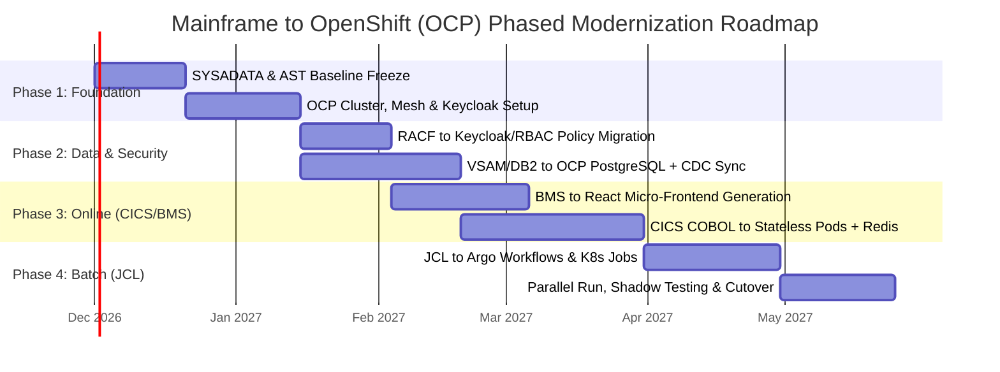

# Mainframe to Red Hat OpenShift (OCP) Modernization Feasibility & Architecture Roadmap

**Generated By:** Pluggable Multi-Engine AST & ADATA Discovery Platform  
**Active Parser Pipeline Mode:** `hybrid` (HYBRID (Lark EBNF + Tree-sitter CST + Regex State Machine))  
**Assessment Date:** 2026-11-18  
**Feasibility Verdict:** **FEASIBLE WITH ARCHITECTURAL REFACTORING** (0 Blockers, 4 High-Complexity Dynamics Identified)  
**Estimated Baseline Engineering Effort:** 51 Person-Days (Core Slice)

---

## 1. Executive Feasibility Verdict & Pluggable Parser Architecture

Deploying this mainframe workload onto **Red Hat OpenShift Container Platform (OCP)** is **100% technically feasible**, provided the migration treats the mainframe not merely as isolated COBOL syntax, but as an integrated runtime ecosystem (CICS Transaction Server, BMS 3270 Terminal UI, RACF Security, EBCDIC Packed-Decimal storage, and JES2 JCL Batch).

### Multi-Engine Parser Switch Architecture
* **Default Hybrid Mode (`--mode hybrid`):** Combines **Lark** (pure-Python EBNF grammar for procedure division statement ASTs), **Tree-sitter** (error-tolerant Concrete Syntax Tree recovery), and **Regex State-Machine** (fast JCL/BMS/RACF/Copybook scanning).
* **Switched Production Compiler Mode (`--mode antlr4_treesitter`):** Switches the AST backend to **ANTLR4 (`antlr4-python3-runtime`)** Visitor streams paired with **Tree-sitter** error recovery.
* **Binary Compiler Enrichment (`SYSADATA`):** Automatically overlays IBM Enterprise COBOL `0x0042` binary symbol records when `.adata` files are present.

---

## 2. Automated AST & System Dependency Topology

### Internal COBOL Control Flow Graph (CFG - Paragraphs & Branching)

---

## 3. Deep-Dive Analysis of Mainframe Dynamics

### 3.1 Multi-Engine AST & IBM SYSADATA Symbol Analysis
| Program ID | Active Parser Engine | ADATA Enriched | Copybooks | Data Symbols | Statement AST Nodes | CST Error Nodes |
| :--- | :--- | :--- | :--- | :--- | :--- | :--- |
| `ACCTMNU` | `HYBRID (Lark EBNF + Tree-sitter CST + Regex State Machine)` | Yes (0x0042) | `CUSTCOPY` | 16 | 13 | 0 |
| `INTBATCH` | `HYBRID (Lark EBNF + Tree-sitter CST + Regex State Machine)` | No | `CUSTCOPY` | 9 | 4 | 0 |

### 3.2 Online UI Dynamics (CICS BMS 3270 Screens -> OCP Micro-Frontend)

| BMS Map | Field Name | 3270 Coordinates | Length | Legacy Attributes | Target OCP React / PatternFly Component |
| :--- | :--- | :--- | :--- | :--- | :--- |
| `ACCTMAP` | `LBLTITLE` | Row 1, Col 25 | 30 | `ASKIP,BRT` | Read-Only Label/Output |
| `ACCTMAP` | `ACCTID` | Row 4, Col 15 | 10 | `UNPROT,IC,FSET` | Editable Text Input |
| `ACCTMAP` | `PASSWD` | Row 5, Col 15 | 8 | `UNPROT,DRK` | Password Input |
| `ACCTMAP` | `CUSTNAM` | Row 7, Col 15 | 30 | `ASKIP` | Read-Only Label/Output |
| `ACCTMAP` | `BALAMT` | Row 8, Col 15 | 12 | `ASKIP,BRT` | Read-Only Label/Output |
| `ACCTMAP` | `ERRMSG` | Row 23, Col 2 | 70 | `ASKIP,BRT` | Read-Only Label/Output |

### 3.3 Security Dynamics (RACF SAF -> OpenShift Zero-Trust Architecture)

| RACF Class | Profile Name | Default UACC | Permitted Groups & Access | Target OpenShift Security Control |
| :--- | :--- | :--- | :--- | :--- |
| `TCICSTRN` | `ACCTMNU` | `NONE` | `BANKTELL:READ, BRANCHMGR:UPDATE` | Keycloak Realm Role + Istio `AuthorizationPolicy` |
| `DATASET` | `PROD.BANK.ACCOUNTS.VSAM` | `NONE` | `BATCHSVC:UPDATE, AUDITOR:READ` | Keycloak Realm Role + Istio `AuthorizationPolicy` |

---

## 4. Target Red Hat OpenShift (OCP) Reference Architecture

---

## 5. Component-Level Readiness & Risk Matrix

| Component | Domain | Severity | Legacy Pattern Detected | Target OCP Architectural Solution | Effort |
| :--- | :--- | :--- | :--- | :--- | :--- |
| `ACCTMNU` | State & Concurrency | **HIGH** | CICS DFHCOMMAREA / Temporary Storage Queue (TSQ) session state | Externalize session state to Red Hat Data Grid (Infinispan) or Redis cluster on OCP; refactor CICS program to stateless REST microservice. | 8d |
| `ACCTMNU` | Security (RACF/SAF) | **HIGH** | Inline EXEC CICS QUERY SECURITY / ASSIGN USERID SAF calls | Replace inline SAF checks with OpenShift Service Mesh (Istio) RequestAuthentication + OIDC JWT claims issued by Red Hat build of Keycloak. | 5d |
| `ACCTMNU` | Data Representation | **MEDIUM** | 2 REDEFINES memory overlays & 2 COMP-3 Packed Decimals (EBCDIC) | Convert EBCDIC Packed Decimal to UTF-8 BigDecimal/Decimal; replace REDEFINES union overlays with polymorphic DTOs or explicit byte-slice parsers. | 6d |
| `ACCTMNU` | Control Flow (AST) | **MEDIUM** | Unstructured branching (1 GO TO jumps across paragraphs) | Apply AST loop-restructuring algorithm before converting paragraphs into modular functions. | 4d |
| `INTBATCH` | Data Representation | **MEDIUM** | 1 REDEFINES memory overlays & 1 COMP-3 Packed Decimals (EBCDIC) | Convert EBCDIC Packed Decimal to UTF-8 BigDecimal/Decimal; replace REDEFINES union overlays with polymorphic DTOs or explicit byte-slice parsers. | 6d |
| `ACCTSET.ACCTMAP` | UI (Online Screens) | **HIGH** | 3270 BMS Terminal Map with 6 positional fields (POS/ATTRB) | Decompile BMS DFHMDF macros into JSON Schema; generate React/PatternFly Micro-Frontend served via NGINX pod on OCP with a Backend-for-Frontend (BFF) validation layer. | 5d |
| `NIGHTLY` | Batch & Storage | **MEDIUM** | Multi-step JCL (2 steps) with VSAM/GDG dataset dependencies | Migrate JCL orchestration to Red Hat OpenShift Pipelines (Tekton) or Argo Workflows; migrate VSAM KSDS files to Cloud-Native PostgreSQL (Crunchy Data / EDB) with indexed tables. | 7d |
| `RACF_SECURITY_DB` | Security (RACF/SAF) | **HIGH** | 2 RACF Resource Profiles (TCICSTRN, DATASET) and Group ACLs | Extract RACF groups to LDAP/Keycloak Realms; enforce API-level RBAC via OpenShift API Management (3scale) and Kubernetes NetworkPolicies. | 10d |

---

## 6. Step-by-Step OCP Migration & Deployment Roadmap

